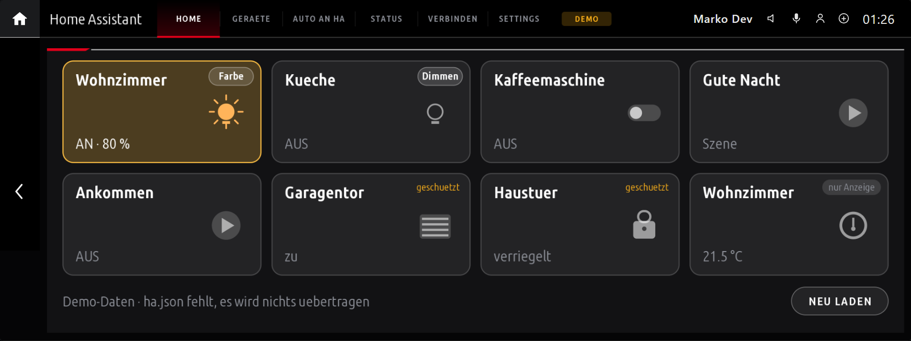
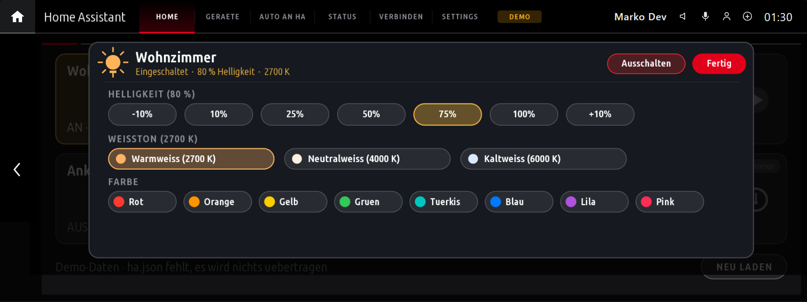
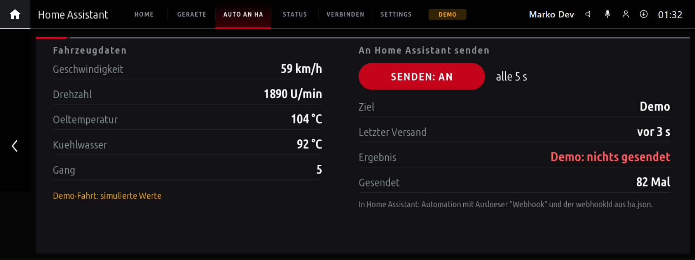
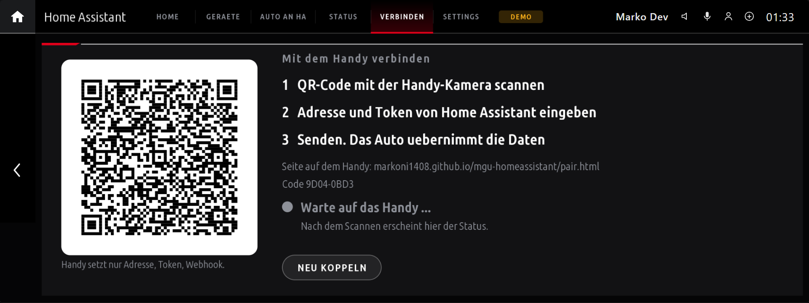
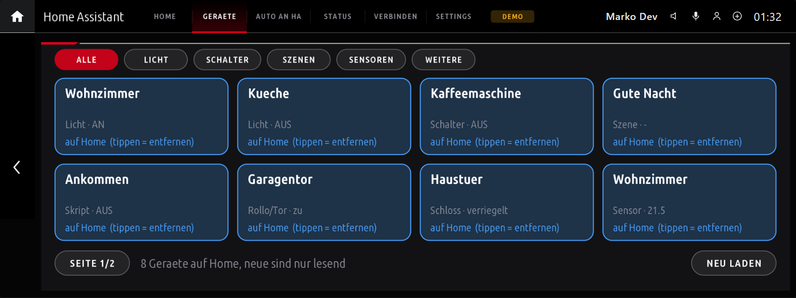

# Home Assistant für BMW iDrive 7 (MGU)

Eine App für den MGU App Store: Home-Assistant-Geräte im Auto ansehen und schalten, und Fahrzeugdaten an Home Assistant senden.  
*A Home Assistant app for the BMW iDrive 7 head unit (MGU): see and switch your devices, and send car data to Home Assistant.*

**Stand: Prototyp.** Getestet nur im PC-Emulator und gegen ein echtes Home Assistant. **Nicht auf einem Auto getestet.**

---

## Screenshots

| Home (Kacheln & Status) | Licht-Einstellungen (Farbe & Helligkeit) |
|:-------------------------:|:---------------------------------------:|
|  |  |

| Fahrzeugdaten an HA | Handy-Kopplung (QR-Code) |
|:-------------------:|:------------------------:|
|  |  |

| Geräte-Übersicht & Auswahl |
|:--------------------------:|
|  |

---

## Was sie kann
- **Home:** Kacheln für Licht, Schalter, Szenen, Skripte, Sensoren. Tippen schaltet (nur wenn freigegeben).
  - **Licht-Einstellungen:** Eigenes Feld auf Licht-Kacheln für Helligkeitsstufen (`-10%`, `10%`, `25%`, `50%`, `75%`, `100%`, `+10%`), Farbtemperatur (Kelvin) und RGB-Farbfelder.
- **Auto an HA:** Tempo, Drehzahl, Öl- und Kühlwassertemperatur, Gang als Webhook an eine Home-Assistant-Automation.
- **Verbinden:** Adresse und Token per Handy eingeben (QR-Code), Ende-zu-Ende verschlüsselt. Es gibt keine Tastatur im Auto.
- **Geraete:** Alle Home-Assistant-Entitäten durchsuchen, nach Kategorien filtern und direkt auf den Home-Bildschirm legen.
- **Status:** Verbindung und Schutzregeln.

## Sicherheit (bitte lesen)
- Standard ist **nur lesen**. Schalten braucht `"control": true` **und** `"allow": true` an dem einzelnen Gerät, beides in `ha.json` im Auto.
- Schloss, Garagentor und Alarmanlage: nur mit `"confirm": true` und zweitem Tippen; die Alarmanlage wird nie geschaltet.
- Das Handy kann nur Adresse, Token und Webhook-ID setzen, **nie** Schalten freigeben.
- Das Token liegt in `ha.json` auf dem Auto. Nimm einen **eigenen Home-Assistant-Benutzer** dafür und sichere deinen Server (https, Zwei-Faktor).
- Sendet die App Fahrzeugdaten, geschieht das nur, wenn du es einschaltest. Die Demo-Fahrt wird nie gesendet.
- Das Fahren erfordert deine volle Aufmerksamkeit. Bedien nichts während der Fahrt, was dich ablenkt. Nutzung auf eigene Gefahr.

## Einrichtung
1. In Home Assistant ein **Langzeit-Token** anlegen (Profil > Sicherheit).
2. Im Auto den Tab **Verbinden** öffnen, QR-Code scannen, Adresse und Token eingeben. (Die Handy-Seite liegt in `docs/`, GitHub Pages: Quelle `main` / `docs`.)
3. Geräte in `ha.json` unter `entities` eintragen (Vorlage: `apps/mdev_homeassistant/ha.example.json`).
4. Für **Fahrzeugdaten an HA**: Automation mit Webhook-Auslöser anlegen (`local_only: false`, wenn das Auto von außen sendet), die ID unter `webhookId` eintragen, in der App "Senden: AN".

## Lizenz
GPL-3.0 oder später (`LICENSE`). Siehe `NOTICE` für Hexlays Kopplungsmodule (GPL-3.0), Project Nayukis QR-Generator (MIT) und das MGU App Kit von cauliflowermossgrape (MIT, `LICENSE.MIT`). Nicht von BMW oder dem Home-Assistant-Projekt.
